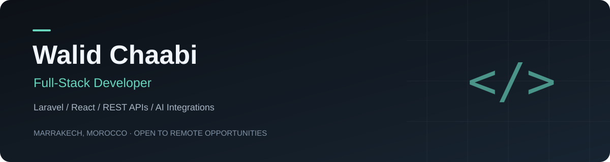

  
  
  

## About me

I'm a full-stack developer based in **Marrakech, Morocco**, with **3+ years of experience** building and maintaining production business applications.

My main focus is **Laravel, PHP, React and Next.js**. I work on backend business logic, REST APIs, authentication, permissions and frontend integration. My experience includes retail platforms, CRM systems and legacy application modernization.

I also build **AI integrations and workflow automations** using n8n, OpenAI and the WhatsApp Cloud API.

## My toolkit

**Core development**

  
  
  
  
  

**Data and delivery**

  
  
  
  
  

**Also working with:** NestJS · Java / Spring Boot · Angular · n8n · OpenAI API

## Selected work

### [01 — Nexa · Retail & POS](https://github.com/WalidChaabi/nexa-platform)

Multi-store retail platform covering products, customers, POS invoices, campaigns and reporting, with role-based workspaces.

**Laravel · Next.js · MySQL**  
[Explore the repository →](https://github.com/WalidChaabi/nexa-platform)

---

### [02 — Hafra · Community Reporting](https://github.com/WalidChaabi/hafra-platform)

Community hazard reporting with maps, photos, confirmations and moderation. A web MVP with an Expo mobile foundation in progress.

**Next.js · NestJS · PostgreSQL · Expo**  
[Explore the repository →](https://github.com/WalidChaabi/hafra-platform)

---

### [03 — ERM · Business Management](https://github.com/WalidChaabi/enterprise-resource-management)

Organization-scoped management of employees, projects, time tracking and leave, with authentication and security workflows.

**Spring Boot · Angular · PostgreSQL**  
[Explore the repository →](https://github.com/WalidChaabi/enterprise-resource-management)

These are portfolio projects. Each repository documents its current scope, setup, tests and remaining work.

## Let's work together

I'm open to **remote full-time roles** and **freelance projects**, especially Laravel/full-stack development, API integrations and business automation.

**[Connect on LinkedIn](https://www.linkedin.com/in/chaabiwalid/)** · **[Send me an email](mailto:wachaabi98@gmail.com)**
